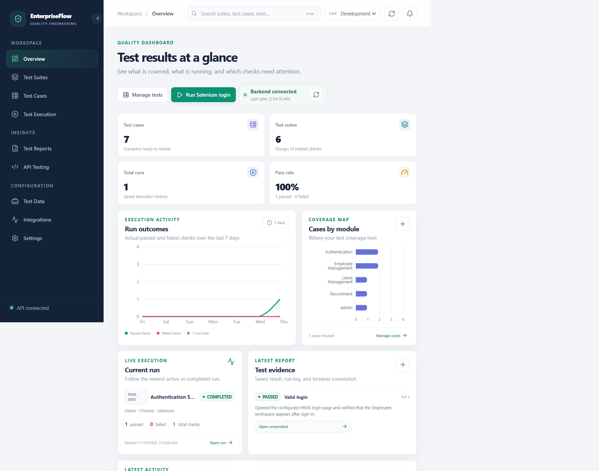
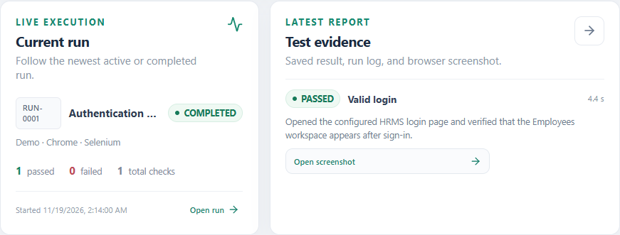
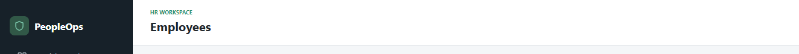
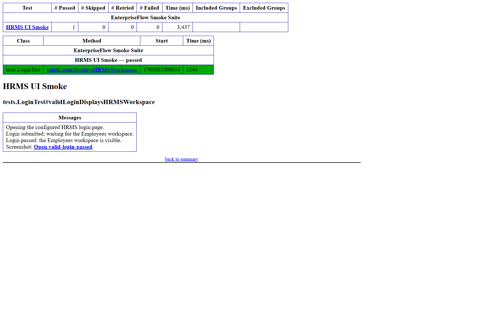
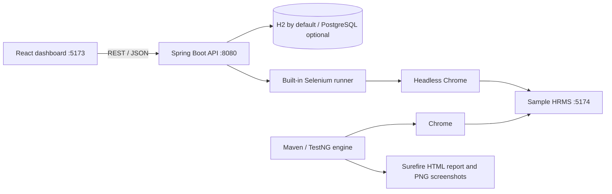

<p align="center">
  
</p>

<h1 align="center">EnterpriseFlow</h1>
<p align="center"><strong>Plan tests. Run checks. Keep the evidence.</strong></p>
<p align="center">
  A practical test-management and browser-automation workspace built with React, Spring Boot, Selenium, and TestNG.
</p>
<p align="center">
  
  
  
  
  
</p>

<p align="center">
  <a href="#quick-start">Quick start</a> ·
  <a href="#screenshots">Screenshots</a> ·
  <a href="#how-testing-works">How testing works</a> ·
  <a href="#troubleshooting">Troubleshooting</a>
</p>

---

## What is EnterpriseFlow?

EnterpriseFlow is a small, full-stack quality-engineering workspace. It helps a team organize test scenarios, record manual reviews, run a real Chrome login check, and inspect the evidence attached to a run.

The project has **two separate Selenium entry points**:

1. **Dashboard run** - started from the web app and executed by the Selenium runner inside the Spring Boot API.
2. **TestNG run** - started from Maven in `automation/selenium-engine` and reported by Surefire/TestNG.

Both use the sample HRMS login page, but the TestNG report is **not imported into the dashboard**. This distinction matters when comparing run history and generated reports.

> **Automation scope:** the built-in browser check covers `TC_AUTH_001` (Valid login) in Chrome. Other test cases are supported as manual, case-by-case reviews; they are not silently presented as automated.

## Screenshots

The screenshots below use a clean demo workspace. The HRMS image is cropped to keep sample employee rows out of the documentation.

### Quality dashboard

The overview puts test counts, pass rate, recent activity, current run status, and saved evidence in one place.



### Run details and evidence

Completed runs show the result, readable execution log, and an action to open the saved browser screenshot.



### Browser target after login

The Selenium check signs into the sample HRMS and verifies that the Employees workspace appears.



### Generated TestNG report

The separate Maven run emits a TestNG/Surefire HTML report with step-by-step output and a screenshot link.



## How testing works

### 1. Organize coverage

- **Test suites** group related scenarios, such as Authentication or Employee Management.
- **Test cases** store an ID, description, preconditions, steps, expected result, priority, module, and automation status.
- The dashboard's test-case and suite pages are backed by the Spring Boot API.

### 2. Run a manual review

Choose a suite and start a manual run. For each case, record **Passed**, **Failed**, or **Skipped**, with an optional note. The result is saved and included in the run summary and CSV export.

Manual review does not open a browser and does not require the sample HRMS to be running.

### 3. Run the dashboard Selenium check

Choose **Selenium login check** in Test Execution. The API launches headless Chrome, opens the sample HRMS, submits the configured login, and checks for the Employees workspace.

The HRMS must be running at `http://localhost:5174` before starting the run. If it is stopped, Chrome reports `ERR_CONNECTION_REFUSED`.

On completion, the dashboard runner stores a result log and screenshot under the configured storage directory. The report links to that screenshot through the API.

### 4. Run the independent TestNG check

`automation/selenium-engine` contains `tests.LoginTest`. It uses `base.BaseTest` for browser setup, config loading, step logging, and screenshot capture. Run it from its own Maven project; it does not start from the dashboard.

## Architecture



### Main components

| Component | Location | Responsibility |
|---|---|---|
| Dashboard | `frontend/dashboard` | Test management, manual reviews, execution history, reports, and API diagnostics |
| API | `backend/enterprise-api` | REST endpoints, database access, built-in Selenium runner, and dashboard report evidence |
| Sample HRMS | `frontend/sample-hrms` | Local browser-automation target |
| TestNG engine | `automation/selenium-engine` | Independent Maven/TestNG login smoke test and HTML report |
| Database setup | `database` and `docker-compose.yml` | Flyway SQL and optional PostgreSQL service |

### Repository map

```text
EnterpriseFlow/
|-- frontend/
|   |-- dashboard/                 # React + TypeScript quality dashboard
|   `-- sample-hrms/                # Local HRMS application used by Selenium
|-- backend/
|   `-- enterprise-api/             # Spring Boot REST API and built-in Selenium runner
|-- automation/
|   `-- selenium-engine/            # Standalone Selenium + TestNG project
|-- database/                       # Database initialization scripts
|-- docs/
|   |-- assets/                     # Project logo
|   `-- screenshots/                # Sanitized README screenshots
|-- docker-compose.yml
`-- README.md
```

## Quick start

### Requirements

- Java 21
- Maven 3.9 or newer
- Node.js 22 or newer (with `npm` available in PowerShell)
- Google Chrome for Selenium runs
- PostgreSQL only if you choose the PostgreSQL profile; the default API uses an in-memory H2 database

Open **separate PowerShell terminals** from the project root and start the services in this order.

#### Terminal 1 - sample HRMS

Start this first so Chrome has a page to visit.

```powershell
Set-Location .\frontend\sample-hrms
npm install
npm run dev -- --host 127.0.0.1 --port 5174 --strictPort
```

Check that `http://localhost:5174` opens before running Selenium.

#### Terminal 2 - API

```powershell
Set-Location .\backend\enterprise-api
mvn spring-boot:run
```

The API uses H2 by default and listens on port `8080`. It also serves Swagger UI at `http://localhost:8080/swagger-ui.html`.

#### Terminal 3 - dashboard

```powershell
Set-Location .\frontend\dashboard
npm install
npm run dev -- --host 127.0.0.1 --port 5173 --strictPort
```

Open `http://localhost:5173`. The dashboard API URL defaults to `http://localhost:8080/api`; set `VITE_API_BASE_URL` before starting Vite to use a different API.

#### Start a dashboard Selenium run

1. Open **Test Execution**.
2. Select **Selenium login check**.
3. Select **Authentication Suite**.
4. Choose **Run Selenium test**.
5. Open the completed run to see its status, log, and screenshot link.

### Run the standalone TestNG engine

Keep the sample HRMS running, then use a fourth terminal:

```powershell
Set-Location .\automation\selenium-engine
mvn test "-DbaseUrl=http://127.0.0.1:5174" "-Dheadless=true"
```

The command should report `Tests run: 1, Failures: 0, Errors: 0` when the sample app is reachable and the login check succeeds.

Generated artifacts:

| Artifact | Location |
|---|---|
| TestNG summary | `automation/selenium-engine/target/surefire-reports/index.html` |
| Email-friendly report | `automation/selenium-engine/target/surefire-reports/emailable-report.html` |
| TestNG screenshots | `automation/selenium-engine/target/surefire-reports/screenshots/` |
| Dashboard-run screenshots | `<STORAGE_DIR>/screenshots/` (defaults to `backend/enterprise-api/storage/screenshots/`) |

`target/` and `storage/` are generated and ignored by Git. The curated, sanitized examples shown in this README are under `docs/screenshots/`.

## Configuration

### Dashboard runner and API

The API reads these environment variables:

| Variable | Default | Description |
|---|---|---|
| `HRMS_URL` | `http://localhost:5174` | Local sample HRMS URL used by the built-in Selenium runner |
| `HRMS_USERNAME` | `admin` | Demo login name |
| `HRMS_PASSWORD` | Demo configuration | Demo login password; use a local-only value |
| `STORAGE_DIR` | `./storage` | Root folder for browser screenshots |
| `DATABASE_URL` | H2 in-memory URL | JDBC URL for H2 or PostgreSQL |
| `DATABASE_USERNAME` | `sa` | Database user |
| `DATABASE_PASSWORD` | empty | Database password |

Set variables in the same terminal before starting the API. For example:

```powershell
$env:HRMS_URL = "http://127.0.0.1:5174"
$env:STORAGE_DIR = ".\storage"
mvn spring-boot:run
```

### TestNG engine

Defaults are in `automation/selenium-engine/src/test/resources/config.properties`. Java system properties override them:

```powershell
mvn test "-DbaseUrl=http://127.0.0.1:5174" "-Dbrowser=chrome" "-Dheadless=true"
```

The engine currently supports Chrome. Do not put personal or production credentials in the checked-in properties file.

## Optional PostgreSQL setup

The project includes a PostgreSQL 16 service for local use:

```powershell
docker compose up -d postgres
$env:DATABASE_URL = "jdbc:postgresql://localhost:5432/enterpriseflow"
$env:DATABASE_USERNAME = "enterpriseflow"
$env:DATABASE_PASSWORD = "enterpriseflow"
Set-Location .\backend\enterprise-api
mvn spring-boot:run
```

The credentials in `docker-compose.yml` are development defaults only. Replace them and use a secret manager for any shared or deployed environment.

To run the complete Docker Compose stack:

```powershell
docker compose up --build
```

## Build and lint

```powershell
# Dashboard
Set-Location .\frontend\dashboard
npm run lint
npm run build

# Sample HRMS
Set-Location .\frontend\sample-hrms
npm run lint
npm run build

# API
Set-Location .\backend\enterprise-api
mvn test

# Selenium / TestNG
Set-Location .\automation\selenium-engine
mvn test "-DbaseUrl=http://127.0.0.1:5174"
```

## Troubleshooting

| Symptom | Likely cause | What to do |
|---|---|---|
| Selenium fails with `ERR_CONNECTION_REFUSED` | HRMS is not running or the configured URL/port is wrong | Start `frontend/sample-hrms` on port `5174`, open it in a browser, then retry |
| `npm` is not recognized | Node.js is missing from this PowerShell session's `PATH` | Install Node.js LTS, reopen VS Code/PowerShell, and check `node --version` and `npm --version` |
| Maven cannot find `spring-boot` | Maven was started outside the API Maven project | Run `mvn spring-boot:run` from `backend/enterprise-api` |
| Screenshot link is missing | The API process has not loaded the screenshot-enabled code, or capture failed | Restart the API after updating it; check the result log and `STORAGE_DIR/screenshots` |
| Chrome cannot start | Chrome is missing or blocked in the environment | Install/update Chrome and rerun; Selenium Manager resolves the matching driver |

## Current scope and known boundaries

- The dashboard Selenium action runs one Chrome login check: `TC_AUTH_001`.
- Other cases use the manual review flow until they have their own automation.
- The standalone TestNG report and dashboard report are separate execution paths.
- The default H2 database is in memory; use PostgreSQL when data must persist across API restarts.
- Demo credentials and Compose database credentials are not production secrets.
